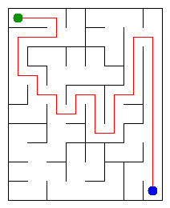

# Assignment 3. Maze Escape

**Student ID:** 253912  
**Name:** Dauren Alaukhan  
**Group:** SE-2519  
**Maze size (rows × columns):** To be confirmed from `data/walls.txt`

This report describes the implementation and results of Assignment 3, Maze Escape.

## Program Output

The program was run using `java -cp out Main`.

```text
Broken: 79
Kept: 63
Last broken wall: 99
MST cost: 25231
Heaviest broken wall: 796
Path length: 32
DFS visited: 50
Dead ends: 23
Zones: 10
Largest zone: 14
Is DAG: 0
Flow stages: 5
Fastest route cost: 20
```

### My Maze



## Questions

### Mission 0. What do `find` and `union` do, and what makes them fast in your code?

The `find` operation returns the representative of the set containing an element. The `union` operation joins two different sets and returns `false` if they are already connected. My implementation uses path compression and union by size, which make these operations very efficient.

### Mission 1. Why is Broken always R × C − 1, and Kept always (R − 1) × (C − 1)?

A maze with R × C cells has R × C vertices, and a connected maze without cycles must have exactly R × C − 1 edges. The broken walls form a spanning tree, while the remaining walls are kept. For the given grid, the number of kept walls is (R − 1) × (C − 1).

### Mission 2. My MST cost from Kruskal and from Prim, and why they are equal

The MST cost produced by Kruskal is **25231**. Prim produces the same total cost, as confirmed by the absence of a warning in the program output. Both algorithms find a minimum spanning tree, although they build it in different ways.

### Mission 3. Why is there exactly one path between two cells? How did you avoid a stack overflow on a huge maze?

The broken walls form a spanning tree, which is connected and contains no cycles. Therefore, exactly one simple path exists between any two cells. I implemented DFS iteratively using an explicit array-based stack instead of recursion, avoiding a stack overflow on a maze of 1000 × 1000 cells.

### Mission 4. Why does the second pass of Kosaraju go on the reversed graph? Why do the slides have no cycle exactly when Zones equals the number of cells?

The first DFS pass records vertices in finishing order. The second pass processes them in reverse finishing order on the reversed graph, allowing each strongly connected component to be identified separately. The slide graph is a DAG exactly when every strongly connected component contains one vertex, so the number of zones equals the number of cells.

### Mission 5. Why is it enough to go through the zones in the order of their numbers? What does this pass cost?

The condensation graph of strongly connected components is a DAG, and the zone numbers are assigned in topological order. Therefore, all incoming edges to a zone are processed before that zone, allowing dynamic programming to calculate the longest chain and cheapest route without a priority queue. Building the zone graph takes O(m) expected time with hash maps, and processing it takes O(Z + Mz), where Z is the number of zones and Mz is the number of distinct edges between zones.

## AI Use

I used **ChatGPT** to understand the assignment requirements, explain Disjoint Set Union, Kruskal, Prim, DFS, Kosaraju, and dynamic programming on the zone graph, and debug my Java implementation. I also used it to interpret compiler errors and test results. The final implementation and report should be reviewed and understood by me before submission.

## Timing (Mission 7)

The following measurements were obtained using `java -cp out Bench`. Each algorithm was run five times for each maze size.

| Maze size | Kruskal runs (ms) | Kruskal average (ms) | Prim runs (ms) | Prim average (ms) |
|---|---|---:|---|---:|
| 100 × 100 | 24, 6, 12, 15, 14 | 14 | 28, 8, 8, 6, 4 | 11 |
| 300 × 300 | 102, 72, 55, 64, 46 | 68 | 92, 72, 74, 78, 97 | 83 |
| 1000 × 1000 | 920, 996, 1045, 962, 1777 | 1140 | 1533, 1744, 1792, 1623, 3541 | 2046 |

The running time increases significantly as the maze grows, especially at 1000 × 1000 cells. In these measurements, Kruskal was faster than Prim on the largest maze, although individual runs varied noticeably. The measurements are affected by the execution environment and should be treated as empirical results rather than universal performance guarantees.

## Complexity

Let `n` be the number of cells or vertices and `m` the number of walls or slides. Let `Z` be the number of zones and `Mz` the number of distinct edges between zones.

| Algorithm | Time | Space | Assumptions |
|---|---|---|---|
| DSU `find` and `union` | O(α(n)) amortized per operation | O(n) | Path compression and union by size |
| Kruskal | O(m log m) | O(n + m) | Sorting all walls and using DSU |
| Prim | O((n + m) log m) | O(n + m) | Adjacency lists and a binary priority queue |
| DFS | O(n + m) | O(n + m) | Iterative DFS with adjacency lists |
| Kosaraju | O(n + m) | O(n + m) | Two iterative DFS passes |
| Route in the zone graph | O(m + Z + Mz) expected | O(Z + Mz) | Hash maps for zone edges and topological zone order |

## Before You Submit

- [ ] `data/walls.txt` and `data/slides.txt` are in the repository.
- [ ] `output/maze.png` and `output/maze.html` correspond to my own maze.
- [ ] `java tools/Check.java` passes all examples.
- [ ] The README is complete, including the program output, AI use, timing, and complexity sections.
- [ ] The repository is public and all required mission changes are committed and pushed to `main`.
- [ ] The GitHub repository link is submitted in Moodle.
